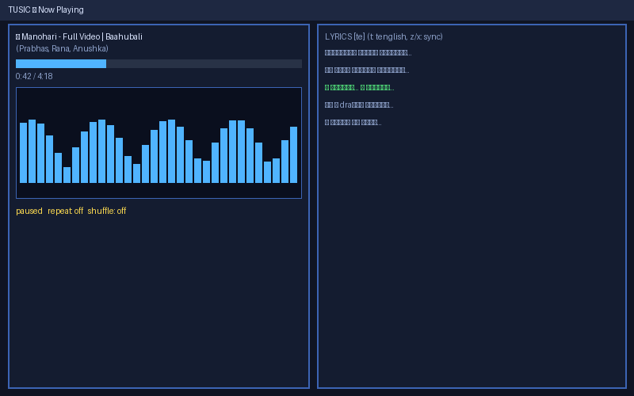

# TUSIC — Terminal Music Player

A terminal music player for Telugu, Hindi, English, and whatever else you search for. Written in Rust, plays through mpv.

   

You can search and play from four sources — JioSaavn, YouTube, SoundCloud, and the Internet Archive — without leaving the terminal. It also has a live spectrum EQ, a DNA-helix visualizer that breathes with the beat, synced lyrics for Telugu/Hindi/English (with romanization), MPRIS desktop control, playlists, and history.

## Features

- Search across four sources at once (JioSaavn, YouTube, SoundCloud, Internet Archive); results get merged and de-duplicated
- Real playback through mpv — no files downloaded, it streams
- Live spectrum EQ with Monstercat-style ballistics and peak hold
- DNA-helix visualizer that expands and contracts with the beat
- Synced lyrics for Telugu, Hindi, and English, romanized so non-Latin scripts stay readable
- Full playback control: seek, pause, volume, repeat (off/all/one), shuffle
- Playlists you can save, load, and delete
- History of recently played tracks plus back-navigation (press H)
- Recommendations (press R) — one key pulls similar songs
- MPRIS 2.1 so media keys and desktop players can drive it
- Loading and progress feedback: gradient comet, shimmer, spinner
- Blue-themed minimal terminal look with transparent panels


## Screenshots




## Requirements

- Linux with PipeWire, PulseAudio, or ALSA
- mpv on your PATH
- ffmpeg (used by the test-tone generator)
- yt-dlp and node (needed for YouTube search)
- Rust 1.75 or newer if you are building from source

```bash
# Debian / Ubuntu / Pop!_OS
sudo apt install -y mpv ffmpeg yt-dlp nodejs
```

## Install and run

```bash
git clone https://github.com/Prasanth-000/tusic.git
cd kalki-music-player
cargo build --release
./target/release/tusic
```

Want a `music` command instead of typing the full path? Symlink it:

```bash
ln -sf "$PWD/target/release/tusic" ~/.local/bin/music && music
```

## Keys

| Key | Action |
|-----|--------|
| `/` | search |
| `j` / `k` | move selection |
| `Enter` | play selected |
| `a` | add to queue |
| `d` | remove from queue |
| `Space` | pause / resume |
| `←` / `→` | seek ±5s |
| `n` / `p` | next / previous |
| `r` | repeat: off → all → one |
| `s` | shuffle toggle |
| `+` / `-` | volume |
| `H` | go back to previous track |
| `R` | recommendations |
| `h` / `1`–`6` | tabs: history, results, queue, library, stats, playlists |
| `:` | commands (`:pl save <name>`, `:pl load <name>`, `:play <query>`, `:vol <n>`) |
| `?` | help |
| `q` | quit |

## Tests

The suite runs against real playback, no mocking:

```bash
# unit tests
cargo test --release

# integration selftests (engine, lyrics, sources, EQ/helix, app, features, logic)
./target/release/tusic --selftest
./target/release/tusic --selftest-lyrics
./target/release/tusic --selftest-sources
./target/release/tusic --selftest-eq
./target/release/tusic --selftest-app
./target/release/tusic --selftest-features
./target/release/tusic --selftest-units

# full end-to-end: 20 real songs from live sources, every feature hammered
./target/release/tusic --selftest-e2e
```

Verified state for v1.0: build plus 7 integration tests all green, `cargo test` 5/5, and a 20-song live end-to-end run that played 20/20 tracks with zero failures. That run includes a pause-regression check confirming pausing never silently switches tracks.

## Security

- Dependency audit (cargo-audit) against the RustSec database: no CVEs. One advisory-grade warning remains, transitive via ratatui — `paste`, an unmaintained macro helper — documented and not exploitable in this app.
- No API keys or secrets. Every source is a public endpoint.
- User input never reaches a shell. Every subprocess call uses argument vectors, and all URLs are percent-encoded.
- SQLite queries use bound parameters only, so there is no SQL-injection surface.
- Uninstall is scoped to its own directory. `uninstall.sh` removes `~/music-player` and the optional `music` shim, nothing else.

## Disclaimer

JioSaavn, YouTube, and SoundCloud streams come from unofficial public endpoints that can change or get rate-limited without notice. This is for personal use; respect each platform's terms of service. On bot-walled networks, YouTube playback may need browser cookies (`yt-dlp --cookies-from-browser`).

## License

MIT. See LICENSE.

Built on Pop!_OS with mpv, ratatui, and a pile of late-night Rust.
